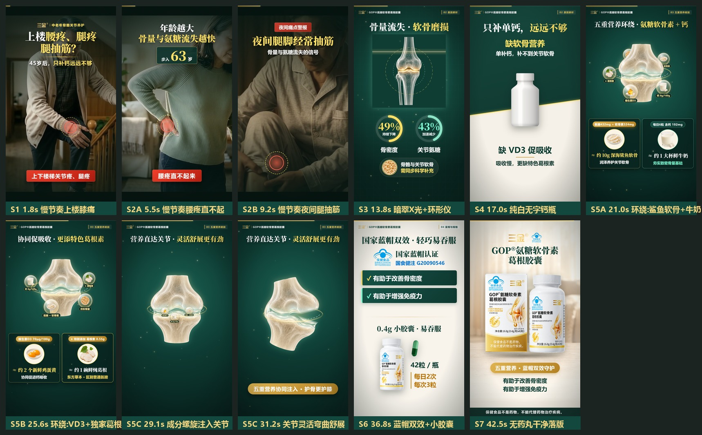
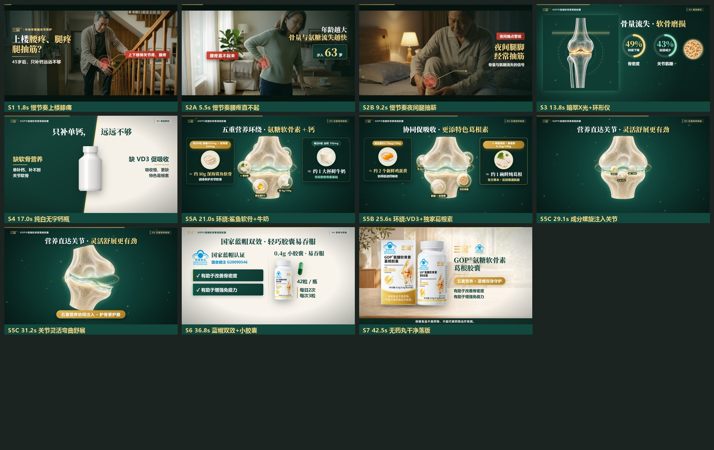
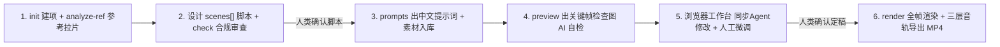

# ecom-tvc-studio

[](https://www.python.org/)
[](LICENSE)
[]()
[]()
[](SKILL.md)

> **通用电商主图 & 短视频 AI 编导工作台（Agent Skill + 浏览器可视化预览台）**
>
> 先让 AI 吃进你的 **参考视频** 自动拉片拆解，或由 AI **原创分镜脚本**；自由编排任意幕数与时长的商业镜头积木，在本地浏览器实时预览与微调，一键渲染带 **BGM + 五层贴画音效 + `edge-tts` 自动闪避配音** 的 **16:9（京东/淘宝主图）** 与 **9:16（抖音/小红书竖屏）** 商用成片。

无需 Node.js、无需复杂前端构建、零付费生图 API 绑定，纯 Python + 浏览器开箱即用，内置 **三金® GOP®氨糖软骨素葛根胶囊** 完整可运行商业 Demo。

---

## 为什么做 `ecom-tvc-studio`？

| 传统痛点 | `ecom-tvc-studio` 的解法 |
| --- | --- |
| **纯 AI 生成视频会把产品包装/蓝帽字改糊** | **官方原图零 AI 重绘原则**：包装盒/瓶、Logo、蓝帽标全程使用官方高清原图合成，AI 只负责痛点实拍、背景与成分静物 |
| **保健品/护肤/食品文案极易触犯广告法** | 内置 **4 品类合规实时校验引擎**（蓝帽 / 食品 / 护肤 / 通用），保存与渲染前自动拦截医疗词与绝对化极限词 |
| **横屏主图和竖屏短视频要重剪两遍** | **同一份 `project.json` 数据源**，原生驱动 16:9 横屏与 9:16 竖屏两套独立排版（非硬裁黑边），一键切换渲染 |
| **拆解爆款参考视频全靠人眼拉进度条** | 内置 `analyze-ref` 智能拉片工具，一键拆出 **时间戳关键帧总览图 + 镜头切点 + 参考底乐 + 初始分镜骨架** |
| **配音、BGM、音效混音门槛高，外放糊成一团** | 自动完成 **BGM 节拍无缝延展 + 五层贴画音效 + `edge-tts` 自动变速防重叠 + 150ms 平滑闪避 + `-14/-15 LUFS`** |

---

## 内置 Demo 效果示例（三金® 氨糖软骨素葛根胶囊）

**9:16 手机竖屏（大字高对比 + 逐条递进阅读节奏 + 五层音效 + 配音闪避）**



**16:9 京东横屏主图（对称信息卡 + 暖阳实景大牌落版）**



---

## 核心能力全景

### 1. 7 种可自由组合的电商商业镜头积木（打破固定幕数限制）

通过 `templates/dynamic_studio.html`，任意项目都可以由 AI 或人工自由增删幕次、设定每幕起止秒数（15s / 25s / 30s / 45s / 60s 皆可），每幕从以下 7 种商用镜头积木中任选：

| 积木类型 (`type`) | 视觉与动效表现 | 适用场景 |
| --- | --- | --- |
| `hero_hook` | 实拍 MP4/静图平缓推镜 + 痛点红圈脉冲 + 黄金 3 秒大字钩子 | 开场痛点直击、场景共鸣 |
| `data_hud` | 透视/机理图 + 扫描光束 + 双指标动态下降/对比仪表盘 | 痛点根源解析、吸收率/存活率对比 |
| `split_contrast` | 左右方案对照卡 + 居中悬浮对照物（无标素瓶/竞品对比） | 新旧方案对比、为什么单一成分不够 |
| `orbit_cards` | 居中主体 + 发光营养/卖点粒子环绕 + 2~4 张类比卡片 | 配方成分拆解、食材/数据具象化类比 |
| `proof_spec` | 浅色高端背书画布 + 扫光卖点条 + 产品规格/包装特写 | 蓝帽认证、检测报告、专利背书、规格剂量 |
| `brand_finale` | 暖阳实景背景 + 官方盒瓶组合大牌落版 + 合规底栏 | 品牌收尾定格、行动引导（CTA） |
| `custom_card` | 全品类万金油高质感图文冲击卡（支持自定义背景图 + 卖点标签） | 任意品类的过渡、活动利益点、场景补充 |

### 2. 多品类广告法合规校验（`engine/compliance.py`）

| 品类模式 (`category`) | 适用类目 | 校验规则 |
| --- | --- | --- |
| `general` | 通用电商（数码/家居/服饰等） | 拦截广告法绝对化极限词（如“第一品牌、顶级、100%有效、永久有效”） |
| `food` | 普通食品 / 功能食品 / 益生菌 | 极限词 + 医疗/疾病宣传词（如“治疗、根治、降血压、抗癌、消炎”） |
| `skincare` | 护肤 / 美妆 / 个护 | 极限词 + 医疗/根治/立竿见影类违禁宣传词 |
| `blue_hat` | 蓝帽保健食品 | 最严格：医疗词 + 极限词 + 强校验底栏必填声明（`保健食品不是药物，不能代替药物治疗疾病。`）+ 批号提醒 |

### 3. 三层商用音轨自动化（`engine/audio_mixer.py`）

1. **参考风底乐（BGM）**：支持网页替换任意 WAV/MP3，短于视频时长时自动节拍交叉淡入淡出无缝延展。
2. **五层动态贴画音效**：自动对齐 `scenes[]` 每一幕的切点与动作——转场 Whoosh + 痛点低频 Thump + 卡片弹出 Pop + 背书清脆 Ding + 落版能量 Bloom。
3. **智能人声配音（`edge-tts`）**：内置 3 种中文商用音色，超长句自动保音高加速（`atempo` 防重叠），发声时 BGM 自动 150ms 平滑闪避，统一输出 `-14 / -15 LUFS` 商用响度。

### 4. SRT 字幕驱动自动拆幕对齐（`engine/srt_sync.py`）

支持在网页上传 `.srt` 或执行 `cli.py sync-srt`，自动识别 UTF-8 / BOM / GBK 编码，按字幕时间戳同步重排画面分镜起止秒数、口播词与五层音效落点（内置示例 [`examples/sample_sanjin.srt`](examples/sample_sanjin.srt)）。

---

## 快速上手（Windows）

### 环境要求
- **Python 3.10+**
- **FFmpeg**（已加入系统 `PATH`，用于抽帧、拉片、混音与封装）
- **Microsoft Edge** 或 **Google Chrome**（用于 Headless CDP 高清逐帧渲染）

### 一键初始化并启动工作台

```powershell
git clone https://github.com/978179571-tech/ecom-tvc-studio.git
cd ecom-tvc-studio

# 1. 自动检查环境并创建 .venv 安装依赖（输出 ENV_PY=<路径>）
python scripts/prepare_env.py

# 2. 启动可视化 Web 工作台（或直接双击 启动工作台.bat）
python app.py
```

启动后浏览器访问：**`http://127.0.0.1:18765`** 即可预览内置三金 Demo，或点击 **`+ 新建产品`** 开始制作全新项目。

---

## 两种使用姿势

### 姿势 A：搭配 AI Agent 作为 Skill 使用（推荐）

本仓库根目录自带 [`SKILL.md`](SKILL.md)、[`AGENTS.md`](AGENTS.md) 与 [`agents/openai.yaml`](agents/openai.yaml)，可直接放入 **Antigravity / Codex / Claude Code** 的 skills 目录，或在仓库根目录直接与 AI 对话：

> **示例指令**：
> *“用 ecom-tvc-studio 给我的「XX 冻干益生菌」做一个 25 秒 9:16 短视频，参考视频在 `D:\ref.mp4`，官方产品图和卖点文档我发你了，品类按普通食品合规审查。”*

AI Agent 会严格按 **6 步门禁确认流程** 与你协同：



### 姿势 B：纯网页可视化工作台操作

1. 点击顶部 **`+ 新建产品`**，输入产品名、英文 ID 和品类合规模式（`general` / `blue_hat` / `food` / `skincare`）；
2. （可选）在左侧 **`🎬 参考视频智能拉片`** 上传一条参考视频 MP4，自动生成分镜骨架与关键帧参考图；
3. 在 **`自由分镜积木编排`** 中增删幕次、调秒数、选积木类型、改文案与口播词，点 **`保存并刷新预览`**；
4. 切到 **`✨ 中文提示词`** 一键复制逐幕生图/视频提示词，用外部工具生成素材后在 **`🖼️ 素材上传`** 替换（官方包装直接传原图）；
5. 切到 **`🔊 音轨与配音`** 勾选 BGM / 音效 / 配音（或上传 `.srt` 字幕自动对齐）；
6. 切换 **`9:16 竖屏`** 或 **`16:9 横屏`**，点 **`11帧预览图`** 检查无误后，点 **`▶ 一键渲染出片`** 即可下载 1080p 成片。

---

## Agent CLI 命令速查（`cli.py`）

所有 CLI 命令均输出确定性 JSON，方便 AI Agent 自动化编排：

```powershell
# 查看所有项目
python cli.py list

# 创建通用自由分镜项目（支持 general / blue_hat / food / skincare）
python cli.py init --id my-probiotics --name "清润高活益生菌" --category food

# 参考视频智能拉片（生成关键帧网格图 + 镜头切点 + 提取底乐 + 写入初始 scenes[]）
python cli.py analyze-ref --video path/to/ref.mp4 --project my-probiotics --extract-audio

# 多品类广告法合规校验（不通过返回非 0 退出码）
python cli.py check --project my-probiotics

# 根据 scenes[] 自动生成逐幕中文生图与图生视频提示词
python cli.py prompts --project my-probiotics

# 导入 SRT 口播字幕自动拆幕并对齐画面、配音与五层音效
python cli.py sync-srt --project my-probiotics --srt examples/sample_sanjin.srt

# 将 16:9 实拍痛点 MP4 自动抽为 24fps 高清帧序列
python cli.py ingest-video --project sanjin-antang --slot frames_02 --file pain1.mp4

# 8~10 秒快速生成全片关键帧检查图（供 AI 视觉自检）
python cli.py preview --project my-probiotics --ratio 9x16
python cli.py preview --project my-probiotics --ratio 16x9

# 渲染完整 1080p 24fps MP4 + 三层商用音轨混音
python cli.py render --project my-probiotics --ratio 9x16

# 启动可视化 Web 工作台（默认 http://127.0.0.1:18765）
python cli.py studio
```

---

## `project.json` 自由分镜结构示例

```json
{
  "project_id": "demo-probiotics",
  "project_name": "清润高活益生菌冻干粉",
  "template_mode": "dynamic",
  "category": "food",
  "duration": 25.0,
  "fps": 24,
  "brand": {
    "brand_name": "清润®",
    "product_name": "清润高活益生菌冻干粉",
    "compliance_footer": "本品为普通食品（固体饮料），不替代药物。"
  },
  "scenes": [
    {
      "id": "s01",
      "type": "hero_hook",
      "start": 0.0,
      "end": 4.8,
      "badge": "01 职场痛点",
      "title": "外卖重油、久坐熬夜，肚子总发胀？",
      "subtitle": "光靠喝酸奶，活菌很难活着到达肠道",
      "highlight": "每天 1 条 · 轻盈无负担",
      "vo_text": "天天吃外卖、久坐又熬夜，饭后肚子总发胀？光靠喝酸奶，活菌很难活着到达肠道。",
      "media": "assets/media/scene1.jpg",
      "items": []
    }
  ],
  "audio": {
    "enable_bgm": true,
    "enable_sfx": true,
    "enable_vo": true,
    "voice": "zh-CN-XiaoxiaoNeural",
    "bgm_gain": 0.46,
    "sfx_scale": 1.0
  }
}
```

---

## 目录结构

```text
ecom-tvc-studio/
├── SKILL.md                     # Agent Skill 入口说明书（6 步门禁确认工作流）
├── AGENTS.md                    # AI Agent 协作协议与 CLI 参考
├── agents/openai.yaml           # Codex / OpenAI Skill 元数据
├── scripts/prepare_env.py       # 一键环境自检与虚拟环境引导（输出 ENV_PY）
├── cli.py                       # Agent 原生 JSON CLI（10 个子命令）
├── app.py                       # 轻量 Web 工作台服务（纯 Python 标准库，端口 18765）
├── 启动工作台.bat                # Windows 双击一键启动脚本
├── engine/
│   ├── ref_analyzer.py          # 参考视频智能拉片引擎（关键帧网格 + 切点 + 底乐提取）
│   ├── compliance.py            # 多品类广告法合规校验（general / blue_hat / food / skincare）
│   ├── prompt_builder.py        # 基于 scenes[] 的动态中文生图 / 图生视频提示词生成器
│   ├── srt_sync.py              # SRT 字幕解析与动态分镜自动对齐引擎
│   ├── renderer.py              # Headless Edge/Chrome CDP + FFmpeg 16:9/9:16 渲染引擎
│   └── audio_mixer.py           # 三层音轨混音引擎（BGM + 动态五层音效 + edge-tts 配音闪避）
├── templates/
│   ├── dynamic_studio.html      # 通用自由分镜积木引擎（支持 16:9 & 9:16 任意幕数与时长）
│   ├── tvc_16x9.html            # 内置三金 Demo 16:9 精修模板
│   └── tvc_9x16.html            # 内置三金 Demo 9:16 精修模板
├── web/
│   └── index.html               # 可视化动态分镜编排工作台前端
├── examples/                    # 16:9 & 9:16 分镜效果图 + sample_sanjin.srt
└── projects/
    └── sanjin-antang/           # 内置完整商业 Demo：三金® 氨糖软骨素葛根胶囊
```

---

## 常见问题（FAQ）

- **Q：需要安装 Node.js 或剪映吗？**
  不需要。前端是零构建原生 HTML/JS，后端是 Python 标准库 `ThreadingHTTPServer`，渲染直接通过本地 Edge/Chrome CDP + FFmpeg 完成。
- **Q：新电脑 `git clone` 下来没有实拍 MP4，能直接预览和渲染吗？**
  可以。内置 Demo 模板自带高清静图兜底与推镜动效，开箱即可直接预览与出片；上传真实 MP4 后自动升级为 24fps 真动态。
- **Q：为什么默认端口是 `18765` 而不是 `8000` / `8765`？**
  Windows 开启 Hyper-V / WSL 后常会保留 `8000–9000` 段端口导致 `WinError 10013` 绑定失败，默认使用 `18765` 可避开系统保留段（也可通过 `python cli.py studio --port <端口>` 自定义）。
- **Q：为什么不直接内置付费生图/生视频 API？**
  为了做到**零 API 密钥门槛**且方便你用任意趁手的工具（即梦 / 可灵 / Seedance / Gemini / Midjourney）把控画质，项目自动生成逐幕中文提示词，一键复制即可外部生成并拖回工作台。

---

## License

[MIT License](LICENSE)
